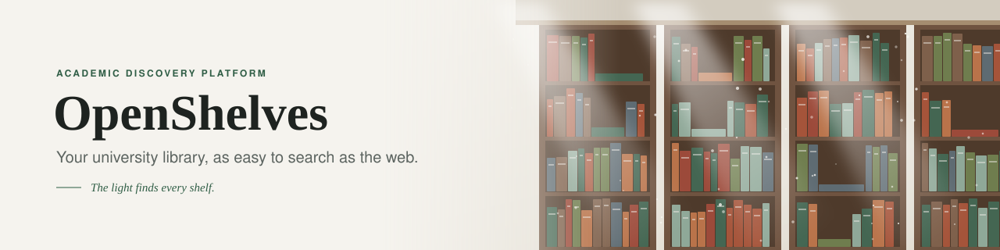
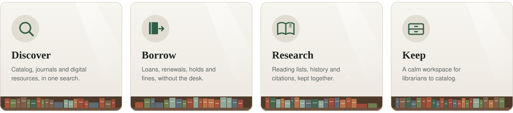
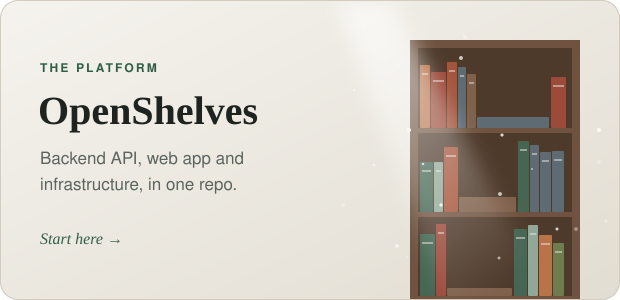
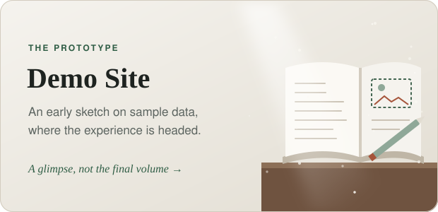

  

*The early light through window glass* 
*lies pale along the patient rows;* 
*the dust drifts slow as hours pass,* 
*and every answer, waiting, glows.*

 

&nbsp;

&nbsp;

 

## 💡 Prologue · Why OpenShelves

Somewhere in every university, the answer to someone's question already sits on a shelf. Too often it is never found: buried under clunky filters, cryptic call numbers and pages that haven't changed in twenty years.

**OpenShelves gives every academic library a modern front door**: as easy to search as the web, as dependable as the archive behind it.

 

## ✨ The Shelves · What it does

  

 

## 🧭 The Ledger · Where we are

> *Every great library began as a single shelf.*

| Chapter | Status | |
|---|---|---|
| **Design** | ✅ Written | API design for every feature, design system, architecture |
| **Sign-in** | 🚧 Being built | Password login and sessions in the API; campus SSO (SAML / OIDC) next |
| **Catalog** | 🚧 Being built | Data model and metadata-provider integrations; search API next |
| **Web app** | 🚧 Being built | Next.js app with the design system; screens shaped from the prototype |
| **Borrowing** | 📋 Planned | Loans, renewals, holds, fines |
| **Research tools** | 📋 Planned | Reading lists, history, notifications |

 

## 🏗️ The Blueprint · How it fits together

 

## 🚀 The Collection · Our projects

  
  &nbsp;&nbsp;&nbsp;
  

### 📚 Reading guides

| Guide | What's inside |
|---|---|
| 📐 **[API design](https://github.com/openshelves-labs/openshelves/blob/main/docs/api-design/README.md)** | Every endpoint, grouped by feature: auth, catalog, loans and more |
| 🎨 **[Design system](https://github.com/openshelves-labs/openshelves/blob/main/docs/Design%20System.md)** | Colours, type and components behind the web app |
| 🖥️ **[Frontend architecture](https://github.com/openshelves-labs/openshelves/blob/main/docs/Frontend%20Architecture.md)** | How the Next.js app is structured and talks to the API |

 

## 🛠️ The Craft · Built with

 

## 🌱 An Open Invitation

The first pages are still being written, which makes now the best time to add yours.

Whether you write code, shape interfaces, keep a library, or simply love the idea, there is a place for you on these shelves.

**→ Begin with the [Contributing Guide](https://github.com/openshelves-labs/openshelves/blob/main/CONTRIBUTING.md).**

 

---

<a href="https://github.com/openshelves-labs/openshelves/blob/main/CODE_OF_CONDUCT.md">Code of Conduct</a> ·
<a href="https://github.com/openshelves-labs/openshelves/blob/main/GOVERNANCE.md">Governance</a> ·
<a href="https://github.com/openshelves-labs/openshelves/blob/main/SECURITY.md">Security</a> ·
<a href="https://github.com/openshelves-labs/openshelves/blob/main/ANTI-IMPERSONATION.md">Anti-Impersonation</a> ·
<a href="https://github.com/openshelves-labs/openshelves/blob/main/LICENSE">License (BUSL 1.1)</a>

  

**© 2026 OpenShelves Labs** · Built with care for the academic community

